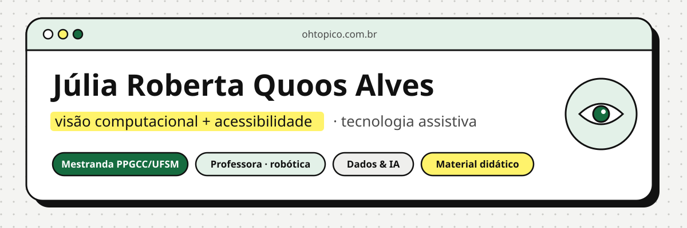

  
  
  

Oi! Eu sou a **Júlia Roberta Quoos Alves**, mestranda em Ciência da Computação no **PPGCC/UFSM**, professora com pós-graduação em robótica e engenheira de dados. Meu trabalho junta duas coisas: **visão computacional que ajuda pessoas cegas a se locomover** e **tecnologia que entra na sala de aula**.

## 🦯 Visão computacional + acessibilidade

No mestrado, pesquiso **modelos leves (MobileNet) para reconhecer cenas e obstáculos** em uma **mochila inteligente** para pessoas cegas ou com baixa visão. Comparo variantes da MobileNet em MIT67, NYU Depth V2 (RGB e RGB-D) e SUN RGB-D, e estou montando um dataset próprio com fotos da UFSM. A demonstração com comandos de voz está em [ohtopico.com.br/teste-mestrado](https://ohtopico.com.br/teste-mestrado).

| Projeto | O que faz |
| --- | --- |
| [**auditor-acessibilidade**](https://github.com/ohtopico/auditor-acessibilidade) `novo` | Analisa páginas da web (axe-core, WCAG 2.2, ordem do Tab) e gera um relatório **em português**, explicando por que cada problema importa e como corrigir. |
| [**segmentacao-cegos**](https://github.com/ohtopico/segmentacao-cegos) | Identifica objetos e estima a proximidade deles para avisar pessoas com deficiência visual. |
| [**sinest-inseut**](https://github.com/ohtopico/sinest-inseut) | Transforma desenho em som: cada cor vira uma nota, lida da esquerda para a direita. |
| [**moedas-brasileiras**](https://github.com/ohtopico/moedas-brasileiras) | Meu primeiro dataset próprio: fotos de moedas classificadas com MobileNetV2 e *transfer learning*. |
| [**summarize-text**](https://github.com/ohtopico/summarize-text) | Sumarizador extrativo para o português, só com a biblioteca padrão do Python. |

## 🤖 Docência e robótica

Dou aula de informática e robótica e faço formação de professores. Tudo o que eu produzo para a sala de aula é aberto e fica em [ohtopico.com.br/material-didatico](https://ohtopico.com.br/material-didatico).

| Projeto | O que faz |
| --- | --- |
| [**arduino-sala-de-aula**](https://github.com/ohtopico/arduino-sala-de-aula) `novo` | Projetos de Arduino com código comentado em português, ligações para o Tinkercad e **plano de aula com BNCC** e adaptações para inclusão. |
| [**materiais-didaticos**](https://github.com/ohtopico/materiais-didaticos) | Atividades interativas em um único HTML: funcionam sem internet e não coletam dados dos alunos. Acompanham o [IA pra Prof](https://ohtopico.com.br/ia-pra-prof/). |
| [**monitor-editais**](https://github.com/ohtopico/monitor-editais) `novo` | Procura concursos e seletivos para professores na Região Central e no Vale do Rio Pardo (RS) e avisa por Telegram ou e-mail, rodando de graça no GitHub Actions. |
| [**site**](https://github.com/ohtopico/site) | O código do [ohtopico.com.br](https://ohtopico.com.br): material didático, simuladores, infográficos interativos e blog. |

## 📊 Dados abertos e outras ferramentas

| Projeto | O que faz |
| --- | --- |
| [**curriculo-json**](https://github.com/ohtopico/curriculo-json) `novo` | Escreva o currículo uma vez em JSON e gere a página web e o PDF, com versões diferentes para cada tipo de vaga. |
| [**dados-censo**](https://github.com/ohtopico/dados-censo) | Censos 2010 e 2022 do IBGE para municípios do Vale do Rio Pardo (RS), com notebooks, planilhas e infográficos. |
| [**site-dados**](https://github.com/ohtopico/site-dados) | O código do [juliaroberta.com](https://juliaroberta.com): projetos, infográficos com dados abertos e currículo de dados. |
| [**online-retail-dataset**](https://github.com/ohtopico/online-retail-dataset) | Previsão de recompra de clientes em 60 dias, com segmentação RFM e comparação de modelos. |
| [**state-of-data-brazil**](https://github.com/ohtopico/state-of-data-brazil) | Análise da pesquisa State of Data Brazil. |

## 🧰 Ferramentas

## 🧭 Trajetória

- **Mestrado (PPGCC/UFSM):** visão computacional para tecnologia assistiva, com defesa prevista para junho de 2027.
- **Docência:** informática no ensino médio, robótica, oficinas para professores de matemática e projetos de extensão em inclusão digital.
- **Iniciação científica (2020-2025):** três projetos de IC em IA, com coleta, análise e visualização de dados.
- **Compass UOL (2019-2020):** engenharia de dados, com data lake na AWS, modelagem SQL e dashboards de People Analytics.
- **Formação:** Ciência da Computação, Administração e Marketing, especialização em Ciência de Dados e Big Data Analytics e pós-graduação em robótica.
- **Certificações:** Google Cloud, Google Analytics e Meta Certified Digital Marketing Associate, todas no [Credly](https://www.credly.com/users/ohtopico/).

## 💬 Vamos conversar?

Topo parcerias em **acessibilidade**, **material didático** e **formação de professores**, e oportunidades em dados e IA. Me chame pelo [LinkedIn](https://www.linkedin.com/in/ohtopico) ou pelo [site](https://ohtopico.com.br).

Fora do computador: Star Trek, Doctor Who, edição na Wikipédia e coleção de moedas 🪙

---

<b>Júlia Roberta Quoos Alves</b> · <a href="https://ohtopico.com.br">ohtopico.com.br</a>

